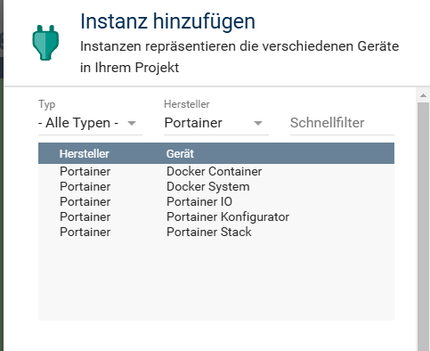
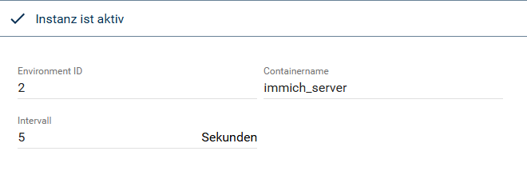
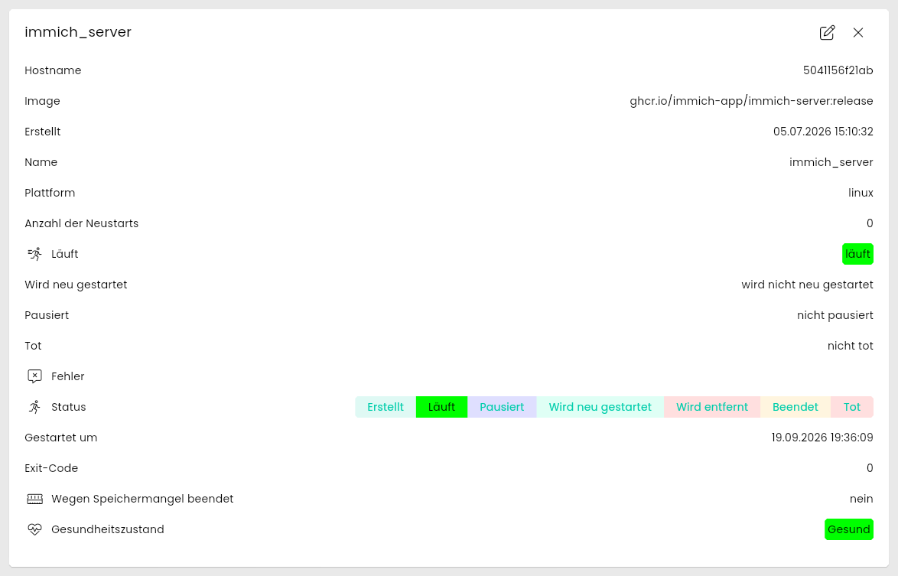
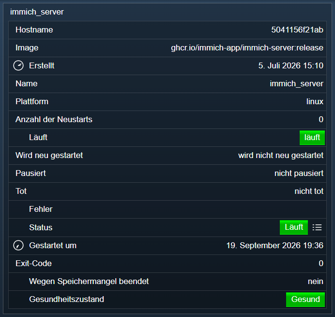

[](https://www.symcon.de/service/dokumentation/entwicklerbereich/sdk-tools/sdk-php/)
[](https://community.symcon.de/t/modul-portainer/142355)
[](https://www.symcon.de/de/service/dokumentation/installation/migrationen/v80-v81-q3-2025/)  
[](#10-lizenz)
[](https://github.com/Nall-chan/Portainer/actions) [](https://github.com/Nall-chan/Portainer/actions)  
[](#2-spenden)
[](#2-spenden)  

# Docker Container <!-- omit in toc -->  

## Inhaltsverzeichnis <!-- omit in toc -->

- [1. Funktionsumfang](#1-funktionsumfang)
- [2. Voraussetzungen](#2-voraussetzungen)
- [3. Software-Installation](#3-software-installation)
- [4. Einrichten der Instanzen in IP-Symcon](#4-einrichten-der-instanzen-in-ip-symcon)
  - [Konfigurationsseite](#konfigurationsseite)
  - [Statuscodes](#statuscodes)
- [5. Statusvariablen](#5-statusvariablen)
- [6. Visualisierung](#6-visualisierung)
  - [Kachel Visualisierung](#kachel-visualisierung)
  - [WebFront Visualisierung](#webfront-visualisierung)
- [7. PHP-Befehlsreferenz](#7-php-befehlsreferenz)
- [8. Aktionen](#8-aktionen)
- [9. Anhang](#9-anhang)
  - [1. Changelog](#1-changelog)
  - [2. Spenden](#2-spenden)
- [10. Lizenz](#10-lizenz)

## 1. Funktionsumfang

- Bildet den Zustand eines Docker-Containers ab: Laufzustand, Gesundheitszustand, Neustarts, Exit-Code, Image und Startzeit.  
- Startet, stoppt, pausiert, setzt fort, startet neu und beendet (Kill) den Container, per PHP-Befehl oder über die Statusvariable `Status`.  

## 2. Voraussetzungen

- IP-Symcon ab Version 8.1
- Portainer Installation mit einem Docker-Environment  
- Eine eingerichtete [Portainer IO](../Portainer%20IO/README.md)-Instanz  

## 3. Software-Installation

- Dieses Modul ist Bestandteil der [Portainer-Library](../README.md#3-software-installation).  

## 4. Einrichten der Instanzen in IP-Symcon

 Unter `Instanz hinzufügen` ist das `Docker Container`-Modul unter dem Hersteller `Portainer` aufgeführt.  
  

> [!TIP]
> Diese Instanz über den [Portainer Konfigurator](../Portainer%20Configurator/README.md) anlegen. Er trägt Environment und Containernamen automatisch ein.

  

### Konfigurationsseite

| Eigenschaft    | Name          | Typ     | Standardwert | Beschreibung                                                                   |
| -------------- | ------------- | ------- | ------------ | ------------------------------------------------------------------------------ |
| Environment ID | EnvironmentId | integer | 0            | ID des Environments in Portainer, in dem der Container läuft                  |
| Containername  | ContainerName | string  | (leer)       | Name des Containers, wie er in Portainer in der Containerliste angezeigt wird |
| Intervall      | Interval      | integer | 5            | Intervall der Statusabfrage in Sekunden, `0` = keine zyklische Abfrage         |

Die **Environment ID** steht in der Adresszeile von Portainer, sobald ein Environment geöffnet ist: bei `https://portainer:9443/#!/2/docker/containers` ist sie `2`.  
Der **Containername** wird ohne führenden Schrägstrich eingetragen (z.B. `mosquitto`). Wird ein Container in Portainer umbenannt oder neu erstellt, muss der Name hier angepasst werden.  

Beispiel für die Einrichtung per Skript:

```php
IPS_SetProperty(12345, 'EnvironmentId', 2);
IPS_SetProperty(12345, 'ContainerName', 'mosquitto');
IPS_SetProperty(12345, 'Interval', 10);
IPS_ApplyChanges(12345);
```

### Statuscodes

| Code | Bedeutung                                                                                                             |
| ---- | --------------------------------------------------------------------------------------------------------------------- |
| 102  | Instanz ist aktiv                                                                                                     |
| 104  | Instanz ist nicht konfiguriert (Environment ID oder Containername fehlt), es wird nicht abgefragt                     |
| 201  | Container nicht gefunden (falscher Name, Container gelöscht oder umbenannt)                                          |
| 202  | Anfrage fehlgeschlagen (andere Fehlermeldung von Portainer)                                                           |

Fehler beim zyklischen Abruf werden nur beim Wechsel des Status im Log gemeldet. Ist der [Portainer IO](../Portainer%20IO/README.md) nicht aktiv, wird nicht abgefragt; sobald er wieder aktiv ist, werden die Statusvariablen sofort aktualisiert.

## 5. Statusvariablen

Die Statusvariablen werden automatisch angelegt, sobald Portainer den jeweiligen Wert liefert.  

| Name                         | Ident            | Typ     | Beschreibung                                                                                           |
| ---------------------------- | ---------------- | ------- | ------------------------------------------------------------------------------------------------------ |
| Hostname                     | Config_Hostname  | string  | Hostname im Container                                                                                  |
| Image                        | Config_Image     | string  | Image, aus dem der Container erstellt wurde                                                            |
| Erstellt                     | Created          | integer | Zeitpunkt, an dem der Container erstellt wurde                                                         |
| Name                         | Name             | string  | Name des Containers                                                                                    |
| Plattform                    | Platform         | string  | Plattform des Containers (z.B. `linux`)                                                                |
| Anzahl der Neustarts         | RestartCount     | integer | Anzahl der automatischen Neustarts durch Docker                                                        |
| Läuft                        | State_Running    | boolean | Container läuft                                                                                        |
| Wird neu gestartet           | State_Restarting | boolean | Container wird gerade neu gestartet                                                                    |
| Pausiert                     | State_Paused     | boolean | Container ist pausiert                                                                                 |
| Tot                          | State_Dead       | boolean | Container ist im Zustand `dead`                                                                        |
| Fehler                       | State_Error      | string  | Letzte Fehlermeldung von Docker beim Starten                                                           |
| Status                       | State_Status     | string  | Zustand des Containers, schaltbar (siehe [8. Aktionen](#8-aktionen))                                   |
| Gestartet um                 | State_StartedAt  | integer | Zeitpunkt des letzten Starts, `-` wenn der Container nie gestartet wurde                               |
| Exit-Code                    | State_ExitCode   | integer | Exit-Code des letzten Laufs, `0` bei laufendem oder sauber beendetem Container, `137` nach Kill        |
| Wegen Speichermangel beendet | State_OOMKilled  | boolean | Container wurde wegen Speichermangel beendet                                                           |
| Gesundheitszustand           | Health_Status    | string  | Ergebnis des Healthchecks: Keine Prüfung, Startet, Gesund, Nicht gesund. Nur bei Images mit Healthcheck |

## 6. Visualisierung

### Kachel Visualisierung

  

### WebFront Visualisierung

  

## 7. PHP-Befehlsreferenz

Alle Befehle geben `true` zurück, wenn Portainer bzw. Docker die Anfrage angenommen hat. Das gilt auch, wenn der Container bereits im gewünschten Zustand ist (z.B. Starten eines laufenden Containers). Bei einem Fehler wird die Meldung von Portainer als Notice ausgegeben (z.B. `HTTP-Fehler 404: No such container: mosquitto`) und `false` zurückgegeben.  
Nach einer erfolgreichen Aktion werden die Statusvariablen nach etwa einer Sekunde automatisch aktualisiert.  

Statusabfrage des Containers und Aktualisierung der Statusvariablen.  

```php
bool PORTAINER_RequestState(integer $InstanzID);
```

Beispiel:  

```php
PORTAINER_RequestState(12345);
```

-------

Starten des Containers.  

```php
bool PORTAINER_StartContainer(integer $InstanzID);
```

Beispiel:  

```php
PORTAINER_StartContainer(12345);
```

-------

Beenden des Containers (Docker sendet zuerst SIGTERM, nach Ablauf der Wartezeit SIGKILL).  

```php
bool PORTAINER_StopContainer(integer $InstanzID);
```

Beispiel:  

```php
PORTAINER_StopContainer(12345);
```

-------

Pausieren des Containers.  

```php
bool PORTAINER_PauseContainer(integer $InstanzID);
```

Beispiel:  

```php
PORTAINER_PauseContainer(12345);
```

-------

Fortsetzen des pausierten Containers.  

```php
bool PORTAINER_UnpauseContainer(integer $InstanzID);
```

Beispiel:  

```php
PORTAINER_UnpauseContainer(12345);
```

-------

Neustarten des Containers.  

```php
bool PORTAINER_RestartContainer(integer $InstanzID);
```

Beispiel:  

```php
PORTAINER_RestartContainer(12345);
```

-------

Zwangsweises Beenden des Containers (SIGKILL).  

```php
bool PORTAINER_KillContainer(integer $InstanzID);
```

Beispiel:  

```php
PORTAINER_KillContainer(12345);
```

## 8. Aktionen

**Grundsätzlich können alle bedienbaren Statusvariablen als Ziel einer [`Aktion`](https://www.symcon.de/service/dokumentation/konzepte/automationen/ablaufplaene/aktionen/) mit `Auf Wert schalten` angesteuert werden, so dass hier keine speziellen Aktionen benutzt werden müssen.**

Die Statusvariable `Status` steuert den Container:

| Auswahl            | Wirkung                                                          |
| ------------------ | ---------------------------------------------------------------- |
| Läuft              | Startet den Container, ein pausierter Container wird fortgesetzt |
| Pausiert           | Pausiert den Container                                           |
| Wird neu gestartet | Startet den Container neu                                        |
| Beendet            | Stoppt den Container                                             |
| Tot                | Beendet den Container zwangsweise (Kill)                         |
| Erstellt           | Nicht möglich, es erscheint eine Fehlermeldung                   |
| Wird entfernt      | Nicht möglich, es erscheint eine Fehlermeldung                   |

## 9. Anhang

### 1. Changelog

[Changelog der Library](../README.md#2-changelog)

### 2. Spenden

  Die Library ist für die nicht kommerzielle Nutzung kostenlos, Schenkungen als Unterstützung für den Autor werden hier akzeptiert:  

[](https://paypal.me/Nall4chan)  

[](https://www.amazon.de/hz/wishlist/ls/YU4AI9AQT9F?ref_=wl_share)

## 10. Lizenz

IPS-Modul:  
[Custom NC-SA](../LICENSE)  
