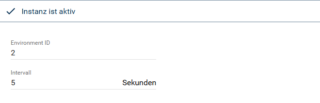
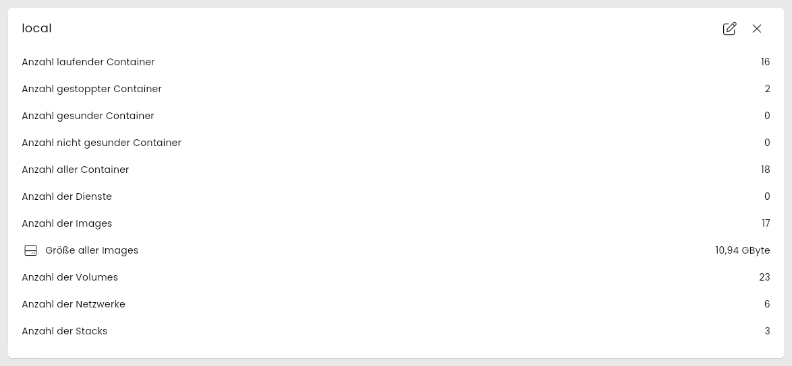
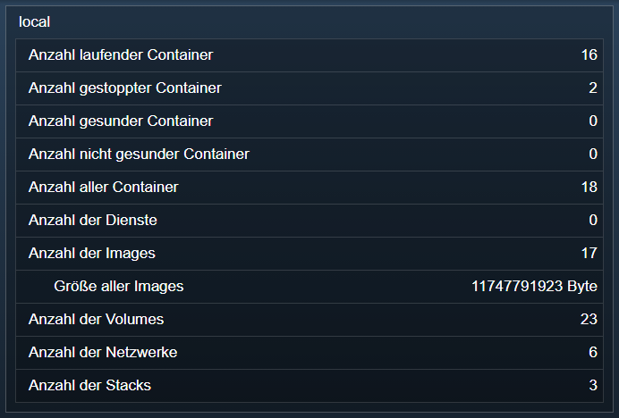

[](https://www.symcon.de/service/dokumentation/entwicklerbereich/sdk-tools/sdk-php/)
[](https://community.symcon.de/t/modul-portainer/142355)
[](https://www.symcon.de/de/service/dokumentation/installation/migrationen/v80-v81-q3-2025/)  
[](#10-lizenz)
[](https://github.com/Nall-chan/Portainer/actions) [](https://github.com/Nall-chan/Portainer/actions)  
[](#2-spenden)
[](#2-spenden)  

# Docker System <!-- omit in toc -->  

## Inhaltsverzeichnis <!-- omit in toc -->

- [1. Funktionsumfang](#1-funktionsumfang)
- [2. Voraussetzungen](#2-voraussetzungen)
- [3. Software-Installation](#3-software-installation)
- [4. Einrichten der Instanzen in IP-Symcon](#4-einrichten-der-instanzen-in-ip-symcon)
  - [Konfigurationsseite](#konfigurationsseite)
  - [Statuscodes](#statuscodes)
- [5. Statusvariablen](#5-statusvariablen)
- [6. Visualisierung](#6-visualisierung)
  - [Kachel Visualisierung](#kachel-visualisierung)
  - [WebFront Visualisierung](#webfront-visualisierung)
- [7. PHP-Befehlsreferenz](#7-php-befehlsreferenz)
- [8. Aktionen](#8-aktionen)
- [9. Anhang](#9-anhang)
  - [1. Changelog](#1-changelog)
  - [2. Spenden](#2-spenden)
- [10. Lizenz](#10-lizenz)

## 1. Funktionsumfang

- Bildet die Übersicht (Dashboard) eines Docker-Environments in Portainer ab: Anzahl der Container nach Zustand, Dienste, Images, Volumes, Netzwerke und Stacks sowie die Größe aller Images.  

## 2. Voraussetzungen

- IP-Symcon ab Version 8.1
- Portainer Installation mit einem Docker-Environment  
- Eine eingerichtete [Portainer IO](../Portainer%20IO/README.md)-Instanz  

## 3. Software-Installation

- Dieses Modul ist Bestandteil der [Portainer-Library](../README.md#3-software-installation).  

## 4. Einrichten der Instanzen in IP-Symcon

 Unter `Instanz hinzufügen` ist das `Docker System`-Modul unter dem Hersteller `Portainer` aufgeführt.  
  

> [!TIP]
> Diese Instanz über den [Portainer Konfigurator](../Portainer%20Configurator/README.md) anlegen. Er bietet sie für jedes Docker-Environment an.

  

### Konfigurationsseite

| Eigenschaft    | Name          | Typ     | Standardwert | Beschreibung                                                           |
| -------------- | ------------- | ------- | ------------ | ---------------------------------------------------------------------- |
| Environment ID | EnvironmentId | integer | 0            | ID des Environments in Portainer                                       |
| Intervall      | Interval      | integer | 5            | Intervall der Statusabfrage in Sekunden, `0` = keine zyklische Abfrage |

Die **Environment ID** steht in der Adresszeile von Portainer, sobald ein Environment geöffnet ist: bei `https://portainer:9443/#!/2/docker/dashboard` ist sie `2`.  

Beispiel für die Einrichtung per Skript:

```php
IPS_SetProperty(12345, 'EnvironmentId', 2);
IPS_SetProperty(12345, 'Interval', 60);
IPS_ApplyChanges(12345);
```

### Statuscodes

| Code | Bedeutung                                                                         |
| ---- | --------------------------------------------------------------------------------- |
| 102  | Instanz ist aktiv                                                                 |
| 104  | Instanz ist nicht konfiguriert (Environment ID fehlt), es wird nicht abgefragt    |
| 201  | Environment nicht gefunden                                                        |
| 202  | Anfrage fehlgeschlagen (andere Fehlermeldung von Portainer)                       |

Fehler beim zyklischen Abruf werden nur beim Wechsel des Status im Log gemeldet. Ist der [Portainer IO](../Portainer%20IO/README.md) nicht aktiv, wird nicht abgefragt; sobald er wieder aktiv ist, werden die Statusvariablen sofort aktualisiert.

## 5. Statusvariablen

Die Statusvariablen werden automatisch angelegt.  

| Name                            | Ident                | Typ                                 |
| ------------------------------- | -------------------- | ----------------------------------- |
| Anzahl laufender Container      | containers_running   | integer                             |
| Anzahl gestoppter Container     | containers_stopped   | integer                             |
| Anzahl gesunder Container       | containers_healthy   | integer                             |
| Anzahl nicht gesunder Container | containers_unhealthy | integer                             |
| Anzahl aller Container          | containers_total     | integer                             |
| Anzahl der Dienste              | services             | integer                             |
| Anzahl der Images               | images_total         | integer                             |
| Größe aller Images              | images_size          | integer (float auf 32-Bit-Systemen) |
| Anzahl der Volumes              | volumes              | integer                             |
| Anzahl der Netzwerke            | networks             | integer                             |
| Anzahl der Stacks               | stacks               | integer                             |

Die Werte stammen aus der Übersicht (Dashboard) von Portainer und werden unverändert übernommen.  
Die Größe aller Images wird in Byte gespeichert. Die Kachel-Visualisierung zeigt sie je nach Größe in kByte, MByte oder GByte an, das WebFront in Byte.

> [!NOTE]
> Auf 32-Bit-Systemen (z.B. Raspberry Pi mit armhf) können Integer-Variablen nur Werte bis 2.147.483.647 speichern, das entspricht 2 GiB. Die Variable `Größe aller Images` wird dort deshalb als Float angelegt.  
> Eine bereits vorhandene Integer-Variable wird nicht automatisch umgestellt, um ihre Archivdaten nicht zu verlieren. Soll sie als Float neu angelegt werden, die Variable löschen. Sie wird bei der nächsten Abfrage neu erstellt.

## 6. Visualisierung

### Kachel Visualisierung

  

### WebFront Visualisierung

  

## 7. PHP-Befehlsreferenz

Statusabfrage des Environments und Aktualisierung der Statusvariablen.  
Gibt `true` zurück, wenn die Statusvariablen aktualisiert wurden. Bei einem Fehler wird die Meldung als Notice ausgegeben und `false` zurückgegeben.  

```php
bool PORTAINER_RequestState(integer $InstanzID);
```

Beispiel:  

```php
PORTAINER_RequestState(12345);
```

## 8. Aktionen

**Grundsätzlich können alle bedienbaren Statusvariablen als Ziel einer [`Aktion`](https://www.symcon.de/service/dokumentation/konzepte/automationen/ablaufplaene/aktionen/) mit `Auf Wert schalten` angesteuert werden, so dass hier keine speziellen Aktionen benutzt werden müssen.**

Dieses Modul hat keine bedienbaren Statusvariablen.  

## 9. Anhang

### 1. Changelog

[Changelog der Library](../README.md#2-changelog)

### 2. Spenden

  Die Library ist für die nicht kommerzielle Nutzung kostenlos, Schenkungen als Unterstützung für den Autor werden hier akzeptiert:  

[](https://paypal.me/Nall4chan)  

[](https://www.amazon.de/hz/wishlist/ls/YU4AI9AQT9F?ref_=wl_share)

## 10. Lizenz

IPS-Modul:  
[Custom NC-SA](../LICENSE)  
