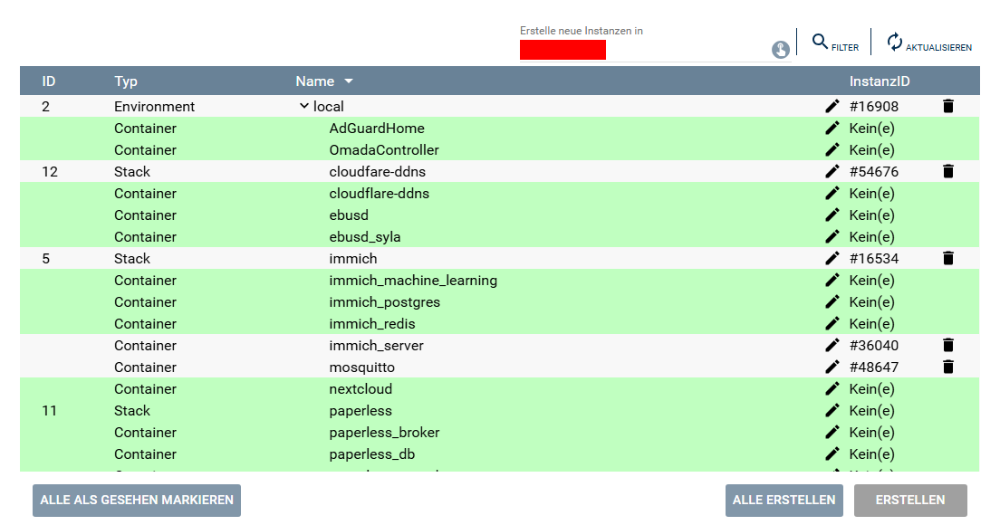

  

   

  

# Portainer Konfigurator <!-- omit in toc -->  

## Inhaltsverzeichnis <!-- omit in toc -->

- [1. Funktionsumfang](#1-funktionsumfang)
- [2. Voraussetzungen](#2-voraussetzungen)
- [3. Software-Installation](#3-software-installation)
- [4. Einrichten der Instanzen in IP-Symcon](#4-einrichten-der-instanzen-in-ip-symcon)
  - [Konfigurationsseite](#konfigurationsseite)
- [5. Statusvariablen](#5-statusvariablen)
- [6. Visualisierung](#6-visualisierung)
- [7. PHP-Befehlsreferenz](#7-php-befehlsreferenz)
- [8. Aktionen](#8-aktionen)
- [9. Anhang](#9-anhang)
  - [1. Changelog](#1-changelog)
  - [2. Spenden](#2-spenden)
- [10. Lizenz](#10-lizenz)

## 1. Funktionsumfang

- Listet alle Environments, Container und Stacks von Portainer als Baum und gleicht sie mit den vorhandenen Instanzen in Symcon ab.  
- Legt [Docker System](../Docker%20System/README.md)-, [Docker Container](../Docker%20Container/README.md)- und [Portainer Stack](../Portainer%20Stack/README.md)-Instanzen mit fertiger Konfiguration an.  

## 2. Voraussetzungen

- IP-Symcon ab Version 8.1
- Portainer Installation  
- Eine eingerichtete [Portainer IO](../Portainer%20IO/README.md)-Instanz (wird beim Anlegen des Konfigurators mit angelegt)  

## 3. Software-Installation

- Dieses Modul ist Bestandteil der [Portainer-Library](../README.md#3-software-installation).  

## 4. Einrichten der Instanzen in IP-Symcon

 Unter `Instanz hinzufügen` ist das `Portainer Konfigurator`-Modul unter dem Hersteller `Portainer` aufgeführt.  

### Konfigurationsseite

Der Konfigurator hat keine Eigenschaften. Er zeigt einen Baum:

- **Environment**: je Environment in Portainer eine Zeile, angelegt wird eine [Docker System](../Docker%20System/README.md)-Instanz. Kubernetes- und Azure-Environments erscheinen als `Environment (nicht unterstützt)` ohne Instanz.  
  - **Container**: alle Container des Environments, auch gestoppte. Angelegt wird eine [Docker Container](../Docker%20Container/README.md)-Instanz.  
  - **Stack**: alle Stacks des Environments. Angelegt wird eine [Portainer Stack](../Portainer%20Stack/README.md)-Instanz.  

Die Spalte `ID` zeigt die ID des Environments bzw. Stacks in Portainer. Neue Container- und Stack-Instanzen werden in einer Kategorie mit dem Namen des Environments angelegt. Alle neuen Instanzen fragen alle 5 Sekunden ab.  
Instanzen, deren Container oder Stack es in Portainer nicht mehr gibt, werden ebenfalls angezeigt und können über den Konfigurator gelöscht werden.  

Die Container werden direkt bei Docker abgefragt. Ist ein Environment offline oder über einen Edge-Agent angebunden, zeigt der Konfigurator die Container aus der letzten Momentaufnahme von Portainer (bis zu 5 Minuten alt).  

Kann der Konfigurator Daten von Portainer nicht lesen, erscheint beim Öffnen ein Hinweis mit der Fehlermeldung. Ist der [Portainer IO](../Portainer%20IO/README.md) nicht aktiv, erscheint der Hinweis `Instanz hat keinen aktiven Parent.`.

## 5. Statusvariablen

Dieses Modul erstellt keine Statusvariablen.  

## 6. Visualisierung

Dieses Modul ist nicht für die Visualisierung geeignet.

## 7. PHP-Befehlsreferenz

Dieses Modul stellt keine Instanz-Funktionen bereit.

## 8. Aktionen

**Grundsätzlich können alle bedienbaren Statusvariablen als Ziel einer [`Aktion`](https://www.symcon.de/service/dokumentation/konzepte/automationen/ablaufplaene/aktionen/) mit `Auf Wert schalten` angesteuert werden, so dass hier keine speziellen Aktionen benutzt werden müssen.**

Dieses Modul hat keine Statusvariablen und keine speziellen Aktionen.  

## 9. Anhang

### 1. Changelog

[Changelog der Library](../README.md#2-changelog)

### 2. Spenden

  Die Library ist für die nicht kommerzielle Nutzung kostenlos, Schenkungen als Unterstützung für den Autor werden hier akzeptiert:  

  

  

## 10. Lizenz

IPS-Modul:  
[Custom NC-SA](../LICENSE)
