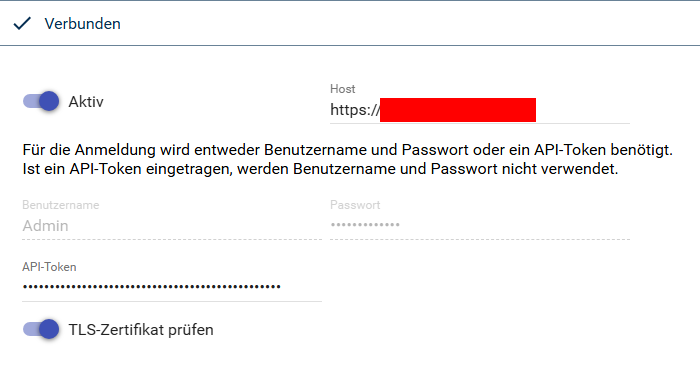

[](https://www.symcon.de/service/dokumentation/entwicklerbereich/sdk-tools/sdk-php/)
[](https://community.symcon.de/t/modul-portainer/142355)
[](https://www.symcon.de/de/service/dokumentation/installation/migrationen/v80-v81-q3-2025/)  
[](#10-lizenz)
[](https://github.com/Nall-chan/Portainer/actions) [](https://github.com/Nall-chan/Portainer/actions)  
[](#2-spenden)
[](#2-spenden)  

# Portainer IO <!-- omit in toc -->  

## Inhaltsverzeichnis <!-- omit in toc -->

- [1. Funktionsumfang](#1-funktionsumfang)
- [2. Voraussetzungen](#2-voraussetzungen)
- [3. Software-Installation](#3-software-installation)
- [4. Einrichten der Instanzen in IP-Symcon](#4-einrichten-der-instanzen-in-ip-symcon)
  - [Konfigurationsseite](#konfigurationsseite)
  - [Statuscodes](#statuscodes)
- [5. Statusvariablen](#5-statusvariablen)
- [6. Visualisierung](#6-visualisierung)
- [7. PHP-Befehlsreferenz](#7-php-befehlsreferenz)
- [8. Aktionen](#8-aktionen)
- [9. Anhang](#9-anhang)
  - [1. Changelog](#1-changelog)
  - [2. Spenden](#2-spenden)
- [10. Lizenz](#10-lizenz)

## 1. Funktionsumfang

- Meldet sich mit Benutzername und Passwort oder mit einem API-Token an Portainer an und leitet die Anfragen der anderen Instanzen der Library an die Portainer API weiter.  
- Bei Benutzername und Passwort: erneuert die Anmeldung alle 7 Stunden (Portainer-Sitzungen laufen nach 8 Stunden ab) und bei abgelaufener Sitzung automatisch. Ein API-Token läuft nicht ab.  
- Nach einer abgelehnten Anmeldung werden keine weiteren Anfragen an Portainer gesendet, bis die Konfiguration übernommen wird oder Symcon die Instanz selbst neu startet. So wird verhindert, dass Portainer den Benutzer wegen vieler fehlerhafter Anmeldungen sperrt.  

## 2. Voraussetzungen

- IP-Symcon ab Version 8.1
- Portainer Installation (getestet mit Portainer CE 2.33.1)  
- Ein Portainer-Benutzer mit Benutzername und Passwort (kein reiner OAuth-Benutzer) oder ein API-Token dieses Benutzers  

## 3. Software-Installation

- Dieses Modul ist Bestandteil der [Portainer-Library](../README.md#3-software-installation).  

## 4. Einrichten der Instanzen in IP-Symcon

 Unter `Instanz hinzufügen` ist das `Portainer IO`-Modul unter dem Hersteller `Portainer` aufgeführt.  
  

> [!TIP]
> Diese Instanz automatisch beim Anlegen des [Portainer Konfigurators](../Portainer%20Configurator/README.md) erzeugen lassen.

  

### Konfigurationsseite

| Eigenschaft           | Name              | Typ     | Standardwert | Beschreibung                                                                            |
| --------------------- | ----------------- | ------- | ------------ | --------------------------------------------------------------------------------------- |
| Aktiv                 | Open              | boolean | false        | Instanz öffnen (`true`) oder schließen (`false`)                                        |
| Host                  | Host              | string  | (leer)       | Adresse von Portainer mit `http://` oder `https://` und Port, ohne `/api`               |
| Benutzername          | Username          | string  | (leer)       | Benutzername für die Anmeldung                                                          |
| Passwort              | Password          | string  | (leer)       | Passwort des Benutzers                                                                  |
| API-Token             | ApiKey            | string  | (leer)       | API-Token eines Portainer-Benutzers. Ist es eingetragen, werden Benutzername und Passwort nicht verwendet |
| TLS-Zertifikat prüfen | VerifyCertificate | boolean | false        | Zertifikat von Portainer prüfen. Aus: auch selbst signierte Zertifikate werden akzeptiert |

Der **Host** ist die Adresse, unter der Portainer im Browser geöffnet wird, z.B. `https://192.168.1.10:9443` oder `https://portainer.example.com`. Ein Schrägstrich am Ende wird ignoriert.  
Ein **API-Token** wird in Portainer über das Benutzerkonto (oben rechts) unter `My account` → `Access tokens` → `Add access token` erstellt und beginnt mit `ptr_`. Es hat dieselben Rechte wie der Benutzer, zu dem es gehört. Ist ein API-Token eingetragen, sind die Felder für Benutzername und Passwort im Formular deaktiviert.  

> [!IMPORTANT]
> `TLS-Zertifikat prüfen` nur einschalten, wenn Portainer ein gültiges Zertifikat für genau diesen Host verwendet (z.B. hinter einem Reverse-Proxy). Mit dem selbst signierten Zertifikat von Portainer oder beim Aufruf über die IP-Adresse schlägt die Verbindung sonst fehl, z.B. mit `Portainer nicht erreichbar: SSL: no alternative certificate subject name matches target ipv4 address`.

Beispiel für die Einrichtung per Skript:

```php
IPS_SetProperty(12345, 'Host', 'https://192.168.1.10:9443');
IPS_SetProperty(12345, 'Username', 'symcon');
IPS_SetProperty(12345, 'Password', 'geheim');
IPS_SetProperty(12345, 'Open', true);
IPS_ApplyChanges(12345);
```

Mit API-Token statt Benutzername und Passwort:

```php
IPS_SetProperty(12345, 'Host', 'https://192.168.1.10:9443');
IPS_SetProperty(12345, 'ApiKey', 'ptr_...');
IPS_SetProperty(12345, 'Open', true);
IPS_ApplyChanges(12345);
```

### Statuscodes

| Code | Bedeutung                     | Ursache                                                                                         |
| ---- | ----------------------------- | ----------------------------------------------------------------------------------------------- |
| 102  | Verbunden                     | Anmeldung erfolgreich                                                                           |
| 104  | Schnittstelle geschlossen     | `Aktiv` ist ausgeschaltet                                                                       |
| 201  | Nicht erreichbar              | Portainer antwortet nicht, oder ein Reverse-Proxy meldet 502/503/504, oder das Zertifikat passt nicht |
| 202  | Nicht autorisiert             | Benutzername oder Passwort falsch, API-Token ungültig oder widerrufen                           |
| 203  | Host fehlt                    | `Host` ist leer                                                                                 |
| 205  | Verbindung verloren           | Portainer war erreichbar und antwortet im laufenden Betrieb nicht mehr                          |

Bei einem Fehlerstatus versucht Symcon die Verbindung automatisch neu aufzubauen. Antwortet Portainer wieder, wechselt der Status auf `Verbunden`.

## 5. Statusvariablen

Dieses Modul erstellt keine Statusvariablen.  

## 6. Visualisierung

Dieses Modul ist nicht für die Visualisierung geeignet.

## 7. PHP-Befehlsreferenz

Dieses Modul stellt keine Instanz-Funktionen bereit.

## 8. Aktionen

**Grundsätzlich können alle bedienbaren Statusvariablen als Ziel einer [`Aktion`](https://www.symcon.de/service/dokumentation/konzepte/automationen/ablaufplaene/aktionen/) mit `Auf Wert schalten` angesteuert werden, so dass hier keine speziellen Aktionen benutzt werden müssen.**

Dieses Modul hat keine Statusvariablen und keine speziellen Aktionen.  

## 9. Anhang

### 1. Changelog

[Changelog der Library](../README.md#2-changelog)

### 2. Spenden

  Die Library ist für die nicht kommerzielle Nutzung kostenlos, Schenkungen als Unterstützung für den Autor werden hier akzeptiert:  

[](https://paypal.me/Nall4chan)  

[](https://www.amazon.de/hz/wishlist/ls/YU4AI9AQT9F?ref_=wl_share)

## 10. Lizenz

IPS-Modul:  
[Custom NC-SA](../LICENSE)  
