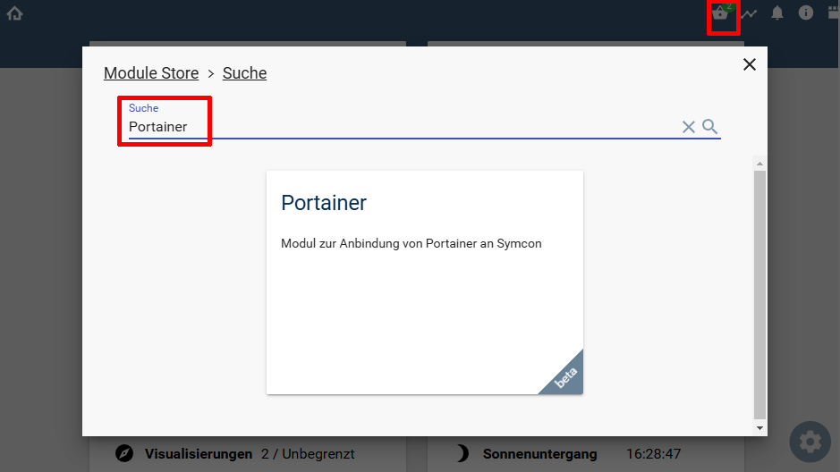
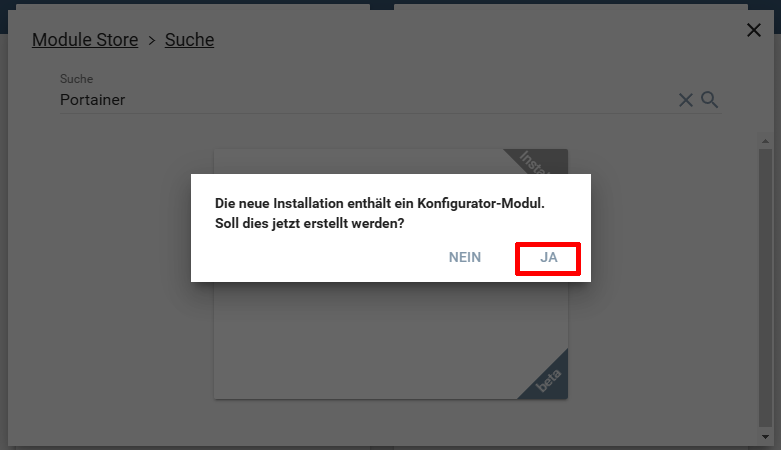
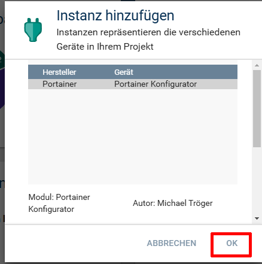
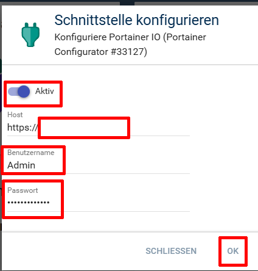
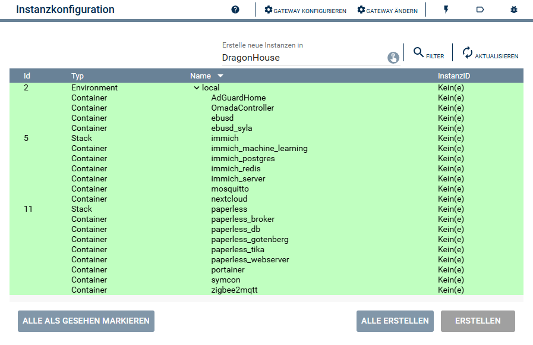

  

   

  

# Portainer <!-- omit in toc -->  

## Inhaltsverzeichnis <!-- omit in toc -->

- [1. Funktionsumfang](#1-funktionsumfang)
- [Vorbemerkungen](#vorbemerkungen)
  - [Zur Library](#zur-library)
  - [Zur Integration von Portainer](#zur-integration-von-portainer)
- [2. Voraussetzungen](#2-voraussetzungen)
- [3. Software-Installation](#3-software-installation)
- [4. Enthaltende Module](#4-enthaltende-module)
- [5. Anhang](#5-anhang)
  - [1. GUID der Module](#1-guid-der-module)
  - [2. Changelog](#2-changelog)
  - [3. Spenden](#3-spenden)
- [6. Lizenz](#6-lizenz)

----------

## 1. Funktionsumfang

Die Library bindet eine [Portainer](https://www.portainer.io/)-Installation an IP-Symcon an:

- Überwachung von Docker-Containern: Zustand, Gesundheitszustand, Neustarts, Exit-Code.
- Steuerung von Docker-Containern: Starten, Stoppen, Pausieren, Fortsetzen, Neustarten und Beenden (Kill), per PHP-Befehl oder über die Statusvariable.
- Überwachung und Steuerung von Portainer-Stacks: Status, Starten und Stoppen.
- Übersicht eines Docker-Environments: Anzahl der Container, Images, Volumes, Netzwerke und Stacks, Größe aller Images.
- Ein Konfigurator listet alle Environments, Container und Stacks und legt die passenden Instanzen an.

## Vorbemerkungen

### Zur Library

Die Library nutzt nur wenige Funktionen der sehr umfangreichen Portainer API.  
Unterstützt werden Docker-Environments. Getestet ist ein lokales Docker-Environment, Environments über Agent oder Edge-Agent sind nicht getestet. Kubernetes- und Azure-Environments werden im Konfigurator angezeigt, es können dafür aber keine Instanzen angelegt werden.  
Die Werte werden zyklisch abgefragt (Standard alle 5 Sekunden), Ereignisse von Docker werden nicht empfangen.

### Zur Integration von Portainer

Die Anmeldung erfolgt mit Benutzername und Passwort eines Portainer-Benutzers oder mit einem API-Token dieses Benutzers. Der Benutzer benötigt Zugriff auf die gewünschten Environments; zum Starten und Stoppen von Containern und Stacks entsprechende Rechte.

> [!IMPORTANT]
> Die Anmeldung mit Benutzername und Passwort funktioniert nicht für Benutzer, die sich nur über OAuth anmelden. Für Symcon einen lokalen Portainer-Benutzer oder ein API-Token verwenden.

Portainer verwendet standardmäßig ein selbst signiertes Zertifikat. Die Prüfung des TLS-Zertifikats ist deshalb im [Portainer IO](Portainer%20IO/README.md) standardmäßig ausgeschaltet und kann dort eingeschaltet werden.

## 2. Voraussetzungen

- IP-Symcon ab Version 8.1
- Portainer Installation (getestet mit Portainer CE 2.33.1)

> [!NOTE]
> Auf 32-Bit-Systemen (z.B. Raspberry Pi mit armhf) können Integer-Variablen nur Werte bis 2.147.483.647 speichern. Größenangaben in Byte (z.B. die Größe aller Images im [Docker System](Docker%20System/README.md#5-statusvariablen)) werden dort als Float-Variable angelegt.

## 3. Software-Installation

  Über den `Module-Store` in IPS das Modul `Portainer` hinzufügen.  
  __Bei kommerzieller Nutzung (z.B. als Errichter oder Integrator) wenden Sie sich bitte an den Autor.__  

  

> [!TIP]
> Die Einrichtung mit dem [Portainer Konfigurator](Portainer%20Configurator/README.md) beginnen. Er legt den [Portainer IO](Portainer%20IO/README.md) mit an und bietet danach alle Environments, Container und Stacks zum Anlegen an.

Nach der Installation aus dem Store wird der Konfigurator auf Rückfrage automatisch angelegt.  
  
  
Dabei wird die Konfiguration bis zum [Portainer IO](Portainer%20IO/README.md) durchlaufen.  
  
Sind die Eingaben korrekt, so wird der [Portainer Konfigurator](Portainer%20Configurator/README.md) geöffnet.  
  

Details zu den einzelnen Instanzen stehen in der Dokumentation der jeweiligen Module.

## 4. Enthaltende Module

Folgende Module beinhaltet die Portainer Bibliothek:

- __Portainer Konfigurator__ ([Dokumentation](Portainer%20Configurator/README.md))  
  Konfigurator, der alle Environments, Container und Stacks von Portainer anzeigt und die passenden Instanzen anlegt.  

- __Portainer IO__ ([Dokumentation](Portainer%20IO/README.md))  
  IO-Instanz für die Anmeldung und Kommunikation mit Portainer.  

- __Portainer Stack__ ([Dokumentation](Portainer%20Stack/README.md))  
  Instanz, die einen Stack von Portainer abbildet und ihn starten und stoppen kann.  

- __Docker Container__ ([Dokumentation](Docker%20Container/README.md))  
  Instanz, die einen Docker-Container abbildet und ihn steuern kann.  

- __Docker System__ ([Dokumentation](Docker%20System/README.md))  
  Instanz, die die Übersicht eines Docker-Environments abbildet.  

## 5. Anhang

### 1. GUID der Module

| Modul                  | Typ          | Prefix    | GUID                                   |
| ---------------------- | ------------ | --------- | -------------------------------------- |
| Portainer IO           | IO           | PORTAINER | {FEB4D3D2-AD8A-9C6A-72D8-DF99AC625768} |
| Portainer Configurator | Configurator | PORTAINER | {781E99AA-6F79-4430-0DF5-388D82E29019} |
| Portainer Stack        | Device       | PORTAINER | {B4110D02-0282-F7F6-363C-906280A3510A} |
| Docker System          | Device       | PORTAINER | {80544234-7E77-8F76-8376-D6C285B58443} |
| Docker Container       | Device       | PORTAINER | {80AA764D-EABE-B85E-D997-43A2D244D6E8} |

### 2. Changelog

__Version 1.0:__  

> [!IMPORTANT]
> - Docker Container, Docker System und Portainer Stack haben eigene Statuscodes (nicht konfiguriert, nicht gefunden, Anfrage fehlgeschlagen). Fehler beim zyklischen Abruf erscheinen nur einmal beim Wechsel des Status im Log, Aufrufe von PHP-Befehlen melden jeden Fehler.
> - Fehlermeldungen von Portainer (z.B. „No such container“) werden jetzt gemeldet; bisher wurden einige Fehler still ignoriert.
> - Die Statusvariable des Stacks wird jetzt als schaltbare Aufzählung dargestellt.
> - Neue Übersetzungen (z.B. Stack „Typ“, Container „Plattform“) gelten nur für neu angelegte Variablen, bestehende Variablen werden nicht umbenannt.
> - Auf 32-Bit-Systemen wird die Größe aller Images als Float angelegt. Eine vorhandene Integer-Variable bleibt erhalten und muss bei Bedarf gelöscht werden.

__Neue Funktionen und Aktionen__  

- Portainer IO: Anmeldung mit API-Token als Alternative zu Benutzername und Passwort.  
- Portainer IO: Option `TLS-Zertifikat prüfen`.  
- Portainer Stack: Starten und Stoppen über die Statusvariable.  

__Neue Statusvariablen__  

- Docker Container: `Exit-Code`, `Wegen Speichermangel beendet`, `Gesundheitszustand` (nur bei Containern mit Healthcheck).  

__Geändertes Verhalten__  

- Portainer IO: neuer Status `Host fehlt`; bei geschlossener Instanz Status `Schnittstelle geschlossen`. Nach einem Verbindungsabbruch wechselt der IO automatisch wieder auf aktiv. Fehlende Rechte auf einzelne Ressourcen (HTTP 403) setzen den IO nicht mehr auf `Nicht autorisiert`.  
- Docker Container, Docker System, Portainer Stack: Aktualisierung sofort, wenn der Portainer IO wieder aktiv wird; bei inaktivem IO wird nicht abgefragt. Nach Aktionen werden die Statusvariablen sofort aktualisiert. Fehler beim Schalten von Statusvariablen werden in der Visualisierung angezeigt.  
- Docker System, Portainer Stack: Neue Instanzen fragen standardmäßig alle 5 Sekunden ab (bisher aus).  
- Portainer Konfigurator: Container werden live abgefragt (auch gestoppte), statt aus dem bis zu 5 Minuten alten Snapshot. Kubernetes-Environments werden ohne Instanz angezeigt, Fehler von Portainer als Hinweis.  

__Behobene falsche Werte in Statusvariablen__  

- Docker Container: `Gestartet um` und `Erstellt` zeigen bei nie gestarteten Containern `-` statt eines Datums im Jahr 1.  
- Docker System: Die Größe aller Images wurde bei genau 1 GiB in der falschen Einheit angezeigt.  

__Fehlerbehebungen__  

- Docker Container: Die Auswahl `Wird neu gestartet` in der Statusvariable hat den Container pausiert statt neu gestartet.  
- Docker Container: Beim Status `Läuft` wurde in der Kachel-Visualisierung kein passendes Symbol angezeigt.  
- Portainer IO: Falsche Zugangsdaten wurden nicht erkannt. Nach einer abgelehnten Anmeldung wurde bei jedem Abruf erneut angemeldet.  
- Portainer IO: Passwörter, Tokens und Umgebungsvariablen von Stacks und Containern erschienen im Klartext im Debug.  
- Portainer Konfigurator: Stacks und Environments mit gleicher ID wurden falsch einsortiert. Fehler bei Environments ohne Snapshot.  

__Version 0.8:__  

- Start der Beta Version  

### 3. Spenden  
  
  Die Library ist für die nicht kommerzielle Nutzung kostenlos, Schenkungen als Unterstützung für den Autor werden hier akzeptiert:  

  

## 6. Lizenz

IPS-Modul:  
[Custom NC-SA](LICENSE)  
